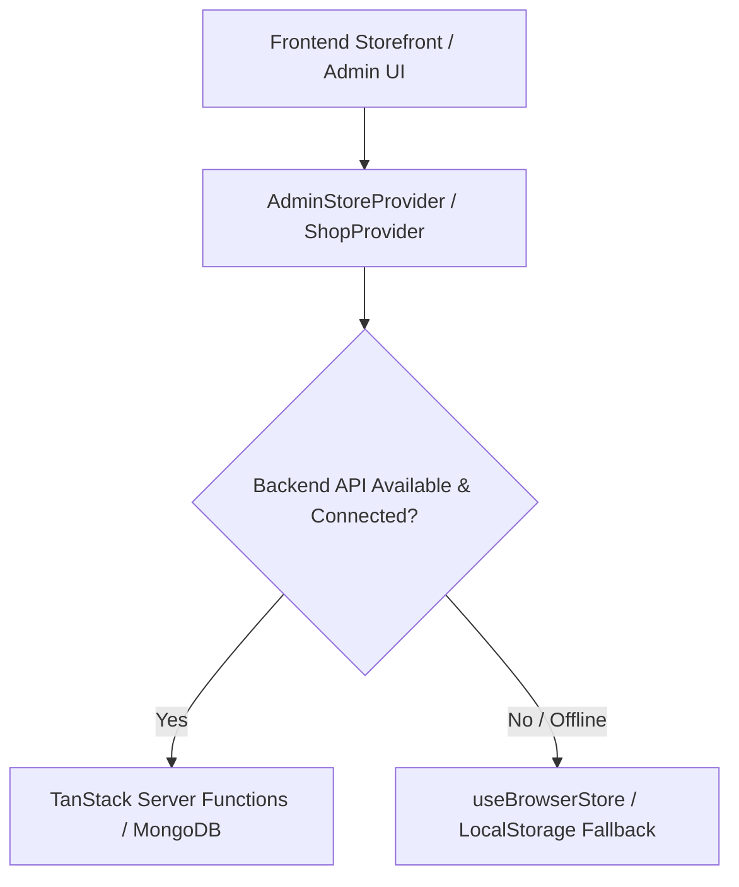
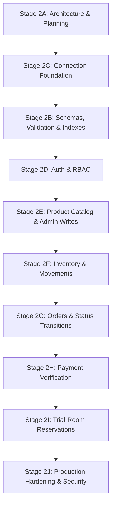

# Siri Shopping Mall: Phase 2 Backend Plan & Architecture Specification

**Status:** APPROVED FOR STAGE 2A (PLANNING ONLY)  
**Date:** October 2026  
**Target Database:** MongoDB Atlas (Node.js Driver)  
**Target Runtime:** Node Server (Nitro `node-server` preset)  
**Security Baseline:** Role-Based Access Control, HttpOnly Session Cookies, Strict Origin & CSRF Validation, Server-Validated Pricing & Stock

---

## 1. Executive Summary & Architectural Decisions

This document defines the comprehensive architecture and execution roadmap for Phase 2: transitioning Siri Shopping Mall from browser-persisted mock stores (`useBrowserStore`) to a production-grade, secure, server-authoritative MongoDB backend while keeping the existing storefront and showroom admin interface completely intact.

### 1.1 Key Architecture Decisions

1. **Hosting & Server Runtime Target:**
   * **Decision:** The production server will target a standard Node.js runtime environment using the Nitro `node-server` preset.
   * **Rationale:** The official `mongodb` Node driver relies on native Node.js TCP networking (`net` and `tls` sockets) and persistent connection pooling. Edge/worker environments (like standard Cloudflare Workers) require custom socket shims or HTTP proxies that degrade reliability.
   * **Atlas Allowlist Implications:** Node servers running in containerized cloud providers (Render, Railway, Docker, AWS ECS) may have dynamic egress IPs. In staging/development, an IP range or temporary developer IP is used. In production, a static outbound NAT gateway / static IP add-on must be assigned and added to the MongoDB Atlas Network Access allowlist, paired with least-privilege `readWrite` database credentials.
   * *Note:* The configuration preset change in `vite.config.ts` will occur in Stage 2C, not in 2A.

2. **Server Function & API Boundary:**
   * **Decision:** Use TanStack Start server functions (`createServerFn`) for all application queries and mutations (Catalog, Inventory, Orders, Coupons, Settings, Admin actions).
   * **Rationale:** Provides end-to-end type safety, automatic Zod payload validation on the server, and integrated CSRF defense.
   * **API Routes:** Dedicated Nitro server routes (`/api/...`) are reserved strictly for external unauthenticated webhooks (e.g., payment gateway callback signatures in Stage 2H) where client RPC wrappers cannot be used.

3. **Multi-Layered CSRF & Origin Defense:**
   * **Current State in [src/start.ts](file:///c:/Users/harsh/Downloads/siriecommerce/src/start.ts):** TanStack Start includes `createCsrfMiddleware({ filter: (ctx) => ctx.handlerType === "serverFn" })`. This validates custom RPC request headers for server functions.
   * **Defense-in-Depth Required:**
     1. All session cookies must enforce `SameSite=Lax` (or `SameSite=Strict` for admin sessions), `httpOnly=true`, and `Secure=true` in production.
     2. All state-changing mutations (`POST`/`PUT`/`DELETE`) will enforce a server-side `Origin` / `Referer` validation matching `APP_URL`.
     3. Client-submitted prices, discounts, and inventory counts are never trusted. All totals are calculated from database records on the server.

4. **Inventory Model & Operational Reality (Design Evaluation):**
   * **Decision:** One shared physical inventory document per variant SKU with fields: `onHand`, `reserved`, and `onlineBuffer`.
   * **Formulas:**
     * Showroom Available = $\max(0, \text{onHand} - \text{reserved})$
     * Online Available = $\max(0, \text{onHand} - \text{reserved} - \text{onlineBuffer})$
   * **Operational Challenge & Risk Flag:** Because the Kandukur showroom has physical walk-in customers sharing the same racks, an item reserved online could theoretically be picked off the rack by a walk-in shopper before staff physically picks and packs it.
   * **Mitigation Protocol:** 
     1. High-turnover or exclusive walk-in items can utilize a positive `onlineBuffer` (units protected for walk-ins).
     2. Order placement must immediately trigger a prominent pick-list alert on the Showroom Admin Dashboard (`/admin/orders` & `/admin/pickup`) so staff immediately bags the physical garment.
     3. Every adjustment or reservation writes an immutable audit log to `inventoryMovements`.

5. **Catalog & Product Variants:**
   * **Decision:** Preserve existing product IDs and URL slugs (`id: 'sage-kurta'`) so existing bookmarks, SEO routes, and links continue functioning.
   * **Variants Structure:** Embedded within each product document: `variants: [{ size: 'M', sku: 'SIRI-SKU-001-M', barcode: '...' }]`. The separate `inventory` collection is indexed directly by `sku`.

6. **Monetary & Tax Standards:**
   * **Decision:** All money values are stored as whole integer rupees (`roundRupees`).
   * **Tax:** Display prices remain tax-inclusive ("Inclusive of all taxes"). Invoicing and tax rate breakdowns (CGST/SGST/IGST) are marked as *Pending Chartered Accountant (CA) confirmation*. Tax percentages will not be hardcoded in schemas; instead, `taxIncluded: true` is tracked in order pricing snapshots.

7. **Pending-Payment & Hold Windows:**
   * Online payment checkout hold: **15 minutes** (stock reserved, auto-released if payment verification fails or times out).
   * Pay-at-Store pickups: Held for **24 hours** after transitioning to `Ready for Pickup`. If uncollected, staff or automated cleanup cancels the order and releases stock.
   * Cash on Delivery (COD): Stock held until staff phone confirmation, then dispatched.

8. **Role-Based Access Control (RBAC):**
   * **Showroom Staff:** View orders, change fulfillment steps (`Preparing at Kandukur Showroom`, `Ready for Pickup`, `Picked Up`, `Shipped`), verify pickup codes at the desk, record inventory adjustments with mandatory reason notes, and manage trial-room bookings.
   * **Owner:** Full staff permissions plus: edit product prices/descriptions/images, publish/unpublish products, create/disable coupons, modify store configuration & delivery fees, and create/deactivate staff accounts.

9. **Customer State (Bag & Wishlist):**
   * Kept client-side. A dedicated frontend task will ensure `bag` and `wishlist` persist in `localStorage` rather than transient React state.

10. **Atlas Free Tier (M0) Production Hardening Requirement:**
    * MongoDB Atlas M0 does **not** provide automated cloud backups, snapshots, or point-in-time recovery.
    * **Requirement:** Transitioning to real customer payments and live orders requires upgrading to an Atlas dedicated cluster (M10+) with automated daily backups, or establishing automated encrypted `mongodump` cron exports.

---

## 2. Directory Structure & Server Conventions

All backend code, database connections, authorization guards, and business logic will live strictly under `src/server/`.

```
src/
├── server/
│   ├── db/
│   │   ├── client.ts             # MongoDB client singleton & connection lifecycle
│   │   ├── collections.ts        # Typed collection accessors
│   │   └── indexes.ts            # Index creation & verification script
│   ├── auth/
│   │   ├── passwords.ts          # Argon2id / bcrypt hashing & verification
│   │   ├── session.ts            # Cryptographic session token generation & lookup
│   │   ├── cookies.ts            # HttpOnly cookie serialization & extraction
│   │   └── guards.ts             # requireAuth(), requireRole('Owner') middleware
│   ├── models/
│   │   ├── types.ts              # Canonical TypeScript database entity types
│   │   └── validators.ts         # Server-side Zod validation schemas
│   ├── utils/
│   │   ├── counters.ts           # Atomic sequence generation (SIRI-1001)
│   │   ├── idempotency.ts        # Idempotency token validation for orders
│   │   ├── pricing.ts            # Server-side order total & tax computation
│   │   └── logger.ts             # Sanitized structured logging (no secrets/PII)
│   └── functions/
│       ├── auth.ts               # login, logout, getSessionUser, createStaffUser
│       ├── catalog.ts            # getPublishedProducts, getProductById, adminUpsertProduct, adminPublishProduct
│       ├── inventory.ts          # getInventorySummary, getProductStock, adminAdjustStock, logMovement
│       ├── orders.ts             # placeOrder, getCustomerOrders, getAdminOrders, updateOrderStatus, verifyPickupCode
│       ├── coupons.ts            # validateCoupon, getActiveCoupons, adminUpsertCoupon, adminToggleCoupon
│       ├── settings.ts           # getPublicSettings, adminUpdateSettings
│       └── reservations.ts       # bookReservation, getReservations, cancelReservation, completeReservation
```

### Server Function Pattern Convention
Every server function adheres to this template:

```ts
import { createServerFn } from '@tanstack/react-start';
import { getWebRequest } from '@tanstack/react-start/server';
import { z } from 'zod';
import { requireRole } from '@/server/auth/guards';
import { sanitizeError } from '@/server/utils/logger';

export const adminSaveProductFn = createServerFn({ method: 'POST' })
  .validator((data: unknown) => productInputSchema.parse(data))
  .handler(async ({ data }) => {
    const request = getWebRequest();
    const user = await requireRole(request, 'Owner');
    try {
      // Execute verified business mutation...
      return { success: true };
    } catch (err) {
      throw sanitizeError(err);
    }
  });
```

---

## 3. Draft Collection Schemas & Indexes

All MongoDB collections use BSON validation constraints and explicit performance/uniqueness indexes.

### 3.1 `users` Collection
Internal showroom staff and owner accounts.

```typescript
interface UserDoc {
  _id: ObjectId;
  email: string;              // Lowercase, trimmed, unique
  passwordHash: string;       // Argon2id or bcrypt hash
  role: 'Owner' | 'Staff';
  name: string;
  phone: string;
  isActive: boolean;
  createdAt: Date;
  updatedAt: Date;
}
```
* **Indexes:**
  * `{ email: 1 }` (Unique)
  * `{ role: 1, isActive: 1 }`

---

### 3.2 `sessions` Collection
Server-authoritative session storage associated with secure `httpOnly` cookies.

```typescript
interface SessionDoc {
  _id: ObjectId;
  tokenHash: string;          // SHA-256 hash of the random session token
  userId: ObjectId;
  role: 'Owner' | 'Staff';
  expiresAt: Date;            // TTL expiration target
  createdAt: Date;
  ipAddress: string;
  userAgent: string;
}
```
* **Indexes:**
  * `{ tokenHash: 1 }` (Unique)
  * `{ expiresAt: 1 }` (`expireAfterSeconds: 0` — MongoDB native TTL index for automatic session pruning)
  * `{ userId: 1 }`

---

### 3.3 `products` Collection
Marketing catalog, imagery, descriptors, and embedded size variant mappings.

```typescript
interface ProductVariant {
  size: string;               // e.g. 'S', 'M', 'L', 'XL', '2–3Y'
  sku: string;                // e.g. 'SIRI-KURTA-SAGE-M'
  barcode?: string;
}

interface ProductDoc {
  _id: ObjectId;
  id: string;                 // URL slug / legacy identifier (e.g. 'sage-kurta')
  name: string;
  sku: string;                // Base product SKU (e.g. 'SIRI-KURTA-SAGE')
  category: 'Women' | 'Men' | 'Boys' | 'Girls';
  subcategory: string;
  price: number;              // Current selling price (integer rupees)
  mrp: number;                // Maximum retail price (integer rupees)
  fabric: string;
  occasion: string;
  color: string;
  sizes: string[];            // ['S', 'M', 'L']
  descriptor: string;
  description: string;
  image: string;              // Validated HTTPS image URL
  tags: string[];
  isNew: boolean;
  isPicked: boolean;
  siriPick: boolean;
  published: boolean;
  popularity: number;
  badge?: string;
  variants: ProductVariant[];
  createdAt: Date;
  updatedAt: Date;
}
```
* **Indexes:**
  * `{ id: 1 }` (Unique)
  * `{ sku: 1 }` (Unique)
  * `{ 'variants.sku': 1 }` (Unique)
  * `{ published: 1, category: 1, occasion: 1 }`
  * `{ published: 1, popularity: -1 }`

---

### 3.4 `inventory` Collection
Live, volatile operational stock counts per variant SKU.

```typescript
interface InventoryDoc {
  _id: ObjectId;
  sku: string;                // Unique variant SKU (e.g. 'SIRI-KURTA-SAGE-M')
  productId: string;          // References product.id
  size: string;
  onHand: number;             // Total physical units present in showroom/stockroom
  reserved: number;           // Units locked for active pending checkouts/unfulfilled orders
  onlineBuffer: number;       // Safety buffer units reserved strictly for walk-ins
  updatedAt: Date;
}
```
* **Indexes:**
  * `{ sku: 1 }` (Unique)
  * `{ productId: 1, size: 1 }` (Unique)
  * `{ onHand: 1, reserved: 1 }`

---

### 3.5 `inventoryMovements` Collection
Append-only immutable audit trail for every single stock change.

```typescript
interface InventoryMovementDoc {
  _id: ObjectId;
  movementId: string;         // UUID or sequential identifier
  sku: string;
  productId: string;
  changeType: 
    | 'CHECKOUT_HOLD'         // Temporary hold during checkout
    | 'CHECKOUT_RELEASE'      // Released upon payment cancellation/timeout
    | 'ORDER_FULFILLED'       // Dispatched or Picked up
    | 'RESTOCK'               // New shipment received
    | 'MANUAL_ADJUSTMENT'     // Showroom staff count reconciliation
    | 'DAMAGE_OR_LOSS';
  quantityDelta: number;      // e.g. -1, +10
  previousOnHand: number;
  newOnHand: number;
  previousReserved: number;
  newReserved: number;
  reason: string;
  actorUserId?: ObjectId;     // Staff/Owner ID if manual; null if system
  orderId?: string;
  timestamp: Date;
}
```
* **Indexes:**
  * `{ sku: 1, timestamp: -1 }`
  * `{ orderId: 1 }`
  * `{ timestamp: -1 }`

---

### 3.6 `orders` Collection
Order documents with embedded immutable item snapshots, pricing calculations, delivery/pickup details, and timelines.

```typescript
interface OrderItemSnapshot {
  productId: string;
  sku: string;
  size: string;
  name: string;
  image: string;
  price: number;              // Purchase price at checkout
  mrp: number;
  quantity: number;
}

interface OrderTimelineEntry {
  status: OrderStatus;
  at: Date;
  actor?: string;             // Staff name or 'System'
  note?: string;
}

interface OrderDoc {
  _id: ObjectId;
  id: string;                 // Display order number (e.g. 'SIRI-1001')
  orderNumber: number;        // Monotonically increasing sequence from counters
  delivery: 'Doorstep' | 'Store Pickup';
  customer: {
    name: string;
    phone: string;
  };
  address: string;            // Formatted delivery address or showroom pickup text
  shippingAddress?: {
    name: string;
    phone: string;
    pin: string;
    street: string;
    landmark?: string;
    city: string;
    state: string;
    type: 'Home' | 'Work' | 'Other';
  };
  items: OrderItemSnapshot[];
  pricing: {
    subtotal: number;         // Sum of MRP * qty
    merchandise: number;      // Sum of price * qty
    couponDiscount: number;
    deliveryFee: number;
    total: number;
    taxIncluded: boolean;     // Pending CA invoice rules
  };
  couponCode?: string;
  payment: {
    method: 'UPI' | 'Card' | 'Cash on delivery' | 'Pay at store';
    status: 'PENDING' | 'PAID' | 'FAILED' | 'REFUNDED' | 'EXPIRED';
    paid: boolean;
    expiresAt?: Date;         // 15 min hold for online, 24 hr hold for ready pickups
    transactionId?: string;
  };
  status: 
    | 'Order Placed'
    | 'Preparing at Kandukur Showroom'
    | 'Ready for Pickup'
    | 'Picked Up'
    | 'Confirmed'
    | 'Packed'
    | 'Shipped'
    | 'Out for Delivery'
    | 'Delivered'
    | 'Cancelled';
  timeline: OrderTimelineEntry[];
  pickupCode?: string;        // e.g. 'SIRI-001001' generated when Ready for Pickup
  courier?: string;
  tracking?: string;
  idempotencyKey?: string;
  createdAt: Date;
  updatedAt: Date;
}
```
* **Indexes:**
  * `{ id: 1 }` (Unique)
  * `{ orderNumber: 1 }` (Unique)
  * `{ 'customer.phone': 1, createdAt: -1 }`
  * `{ status: 1 }`
  * `{ 'payment.expiresAt': 1 }` (For automated expiration workers)
  * `{ idempotencyKey: 1 }` (Unique, sparse)
  * `{ createdAt: -1 }`

---

### 3.7 `coupons` Collection
Promotional discount rules with server validation constraints.

```typescript
interface CouponDoc {
  _id: ObjectId;
  code: string;               // Uppercase alphanumeric (e.g. 'SIRI10')
  kind: 'percent' | 'fixed';
  value: number;
  minimum: number;            // Minimum merchandise subtotal required
  maxDiscount: number;        // Maximum discount cap in rupees (0 = uncapped)
  expiry: string;             // YYYY-MM-DD or empty
  enabled: boolean;
  title: string;
  note: string;
  usageLimit?: number;
  usedCount: number;
  createdAt: Date;
  updatedAt: Date;
}
```
* **Indexes:**
  * `{ code: 1 }` (Unique)
  * `{ enabled: 1, expiry: 1 }`

---

### 3.8 `settings` Collection
Showroom operational details, delivery thresholds, and contact information.

```typescript
interface SettingsDoc {
  _id: 'singleton_settings';
  name: string;
  address: string;
  phone: string;
  whatsapp: string;
  hours: string;
  fee: number;
  freeAt: number;
  deliveryMinDays: number;
  deliveryMaxDays: number;
  pickupReadyHours: number;
  exchangeDays: number;
  trialRoomsCount: number;    // Number of physical fitting rooms available
  holds: {
    onlinePaymentHoldMinutes: number; // 15
    pickupHoldHours: number;          // 24
  };
  tax: {
    included: boolean;        // true
    comment: string;          // 'Pending CA confirmation'
  };
  updatedAt: Date;
}
```
* **Indexes:**
  * `_id` primary key.

---

### 3.9 `reservations` Collection
Customer trial-room fitting appointments at the Kandukur showroom.

```typescript
interface ReservationItem {
  productId: string;
  sku: string;
  size: string;
  name: string;
}

interface ReservationDoc {
  _id: ObjectId;
  id: string;                 // e.g. 'TRIAL-1001'
  date: string;               // YYYY-MM-DD
  slot: string;               // e.g. '11:00 AM' (30-minute intervals)
  name: string;
  phone: string;
  items: ReservationItem[];   // Enforced maximum 5 items
  status: 'Upcoming' | 'Completed' | 'Cancelled';
  roomNumber?: number;
  createdAt: Date;
  updatedAt: Date;
}
```
* **Indexes:**
  * `{ id: 1 }` (Unique)
  * `{ date: 1, slot: 1, status: 1 }`
  * `{ phone: 1, date: 1 }`

---

### 3.10 `counters` Collection
Atomic sequence generation for user-friendly numbers.

```typescript
interface CounterDoc {
  _id: string;                // e.g. 'orderNumber', 'reservationNumber'
  seq: number;
}
```

---

## 4. Server Functions Specification & RBAC Matrix

All mutations require input validation via shared Zod schemas before database queries execute.

| Domain | Server Function | Allowed Caller / Role | Description & Input Constraints |
| :--- | :--- | :--- | :--- |
| **Auth** | `loginFn` | Public (Unauthenticated) | Validates `{ email, password }`, verifies hash, creates session, sets HttpOnly cookie. Rate-limited. |
| **Auth** | `logoutFn` | Authenticated (Any) | Invalidates session in DB, clears session cookie. |
| **Auth** | `getSessionUserFn` | Authenticated (Any) | Returns current user profile `{ name, role, email }`. |
| **Auth** | `adminCreateStaffFn` | **Owner Only** | Creates staff user `{ email, password, name, phone }`. |
| **Catalog** | `getPublishedCatalogFn` | Public | Fetches published products with active variants for PLP/PDP. Cached. |
| **Catalog** | `getProductByIdFn` | Public | Fetches single published product by slug/id with size availability. |
| **Catalog** | `adminGetCatalogFn` | Staff / Owner | Returns all products including draft and unpublished items. |
| **Catalog** | `adminSaveProductFn` | **Owner Only** | Validates `productSchema`, upserts product and ensures variant rows exist. |
| **Catalog** | `adminSetPublishFn` | **Owner Only** | Toggles product `published` status. |
| **Inventory** | `getPublicStockFn` | Public | Returns size availability indicators (`In Stock`, `Low Stock`, `Out of Stock`) without leaking exact count numbers. |
| **Inventory** | `adminGetStockFn` | Staff / Owner | Returns exact `onHand`, `reserved`, `onlineBuffer` counts for SKU search. |
| **Inventory** | `adminAdjustStockFn` | Staff / Owner | Atomically adjusts stock with mandatory `{ sku, delta, reason }`; writes to `inventoryMovements`. |
| **Orders** | `placeOrderFn` | Public (Customer) | Validates address, recomputes pricing on server, verifies stock, reserves hold, creates `SIRI-xxxx` order with `idempotencyKey`. |
| **Orders** | `getOrderDetailsFn` | Public (Scoped) | Validates customer phone + order ID or pickup code to return tracking. |
| **Orders** | `adminGetOrdersFn` | Staff / Owner | Filtered order query by mode, status, date, or query string. |
| **Orders** | `adminUpdateOrderStatusFn`| Staff / Owner | Enforces valid status state machine transitions (`transitionOrder`); logs timeline. |
| **Orders** | `adminVerifyPickupFn` | Staff / Owner | Validates pickup code (`SIRI-xxxxxx`), displays order details, marks as `Picked Up`. |
| **Coupons** | `validateCouponFn` | Public | Checks coupon code against active items and cart total, returns calculated discount. |
| **Coupons** | `adminGetCouponsFn` | **Owner Only** | Retrieves full coupon list with usage metrics. |
| **Coupons** | `adminSaveCouponFn` | **Owner Only** | Creates or updates coupon code, discount rules, caps, and expiry dates. |
| **Settings** | `getSettingsFn` | Public | Retrieves showroom address, WhatsApp contact, delivery fees, and hours. |
| **Settings** | `adminSaveSettingsFn`| **Owner Only** | Updates delivery thresholds, timings, showroom contact, and trial room limits. |
| **Reservations**| `bookReservationFn` | Public | Books trial-room slot (max 5 items, within next 7 days). Validates slot room capacity. |
| **Reservations**| `cancelReservationFn` | Public / Staff | Cancels reservation up to 2 hours before the scheduled slot. |
| **Reservations**| `adminGetReservationsFn`| Staff / Owner | Queries upcoming reservations by date. |
| **Reservations**| `adminCompleteReservationFn`| Staff / Owner | Marks reservation as `Completed`. |

---

## 5. Migration Strategy for Browser-Store Slices

The frontend currently uses [src/admin/store.tsx](file:///c:/Users/harsh/Downloads/siriecommerce/src/admin/store.tsx) (`useBrowserStore('siri-shared-store-v1')`). To maintain a working application throughout Phase 2, each slice will transition progressively using the **Adapter Fallback Pattern**.



### Slice-by-Slice Migration Plan

1. **Settings Slice (First Target):**
   * *Phase 2C/2E:* Fetch settings via `getSettingsFn()`.
   * *Fallback:* If MongoDB query returns null or network error occurs, fall back to `siriConfig` from [src/config/siri.ts](file:///c:/Users/harsh/Downloads/siriecommerce/src/config/siri.ts).
2. **Coupons Slice:**
   * *Phase 2E:* Read enabled coupons from `getPublishedCatalogFn()` / `validateCouponFn()`.
   * *Admin:* Edits route to `adminSaveCouponFn()`.
3. **Products & Catalog Slice:**
   * *Phase 2E:* [src/routes/shop.tsx](file:///c:/Users/harsh/Downloads/siriecommerce/src/routes/shop.tsx) and [src/routes/product.$id.tsx](file:///c:/Users/harsh/Downloads/siriecommerce/src/routes/product.$id.tsx) switch their route loaders to call `getPublishedCatalogFn()` and `getProductByIdFn()`.
   * The catalog seed data in [src/lib/shop/catalog.ts](file:///c:/Users/harsh/Downloads/siriecommerce/src/lib/shop/catalog.ts) serves as the database initial migration seed.
4. **Inventory Slice:**
   * *Phase 2F:* [src/admin/operations.tsx](file:///c:/Users/harsh/Downloads/siriecommerce/src/admin/operations.tsx) switches from reading `useAdminStore().stock` to querying `adminGetStockFn()`. Save operations trigger `adminAdjustStockFn()`.
5. **Orders Slice:**
   * *Phase 2G:* Checkout form submits to `placeOrderFn()`. The returned verified order is saved in the database.
   * Customer orders page `/account` and admin `/admin/orders` fetch from `adminGetOrdersFn()`.
6. **Reservations Slice:**
   * *Phase 2I:* Booking form and `/admin/reservations` hook directly into `bookReservationFn()` and `adminGetReservationsFn()`.
7. **Bag & Wishlist (Client-Only UI Task):**
   * `ShopProvider` in [src/components/shop/shop-provider.tsx](file:///c:/Users/harsh/Downloads/siriecommerce/src/components/shop/shop-provider.tsx) will be updated to persist `bag` and `wishlist` in browser `localStorage` (`siri-bag-v1`, `siri-wishlist-v1`), ensuring customer cart items survive page reloads and tab closures without requiring premature customer account setup.

---

## 6. Stage-by-Stage Implementation Roadmap (2C – 2J)

As required, no admin write endpoints will be exposed before Stage 2D (Authentication & RBAC).



---

### Stage 2C: Backend Foundation and Safe Database Connection
* **Goal:** Establish a robust, resilient MongoDB client singleton, configure environment variable parsing with validation, and switch the server runtime preset to Node.
* **Acceptance Criteria:**
  1. `src/server/db/client.ts` exports `getMongoClient()` and `getDb()` with connection pooling and graceful shutdown handlers (`SIGTERM`, `SIGINT`).
  2. Database credentials are read strictly on the server from environment variables; missing variables throw actionable configuration errors.
  3. [vite.config.ts](file:///c:/Users/harsh/Downloads/siriecommerce/vite.config.ts) configures `nitro: { preset: 'node-server' }` for production Node builds.
  4. A connectivity verification CLI script (`npm run db:check`) verifies ping to MongoDB Atlas without logging connection strings.
* **Files Affected:**
  * `package.json` (Add `mongodb` dependency)
  * [vite.config.ts](file:///c:/Users/harsh/Downloads/siriecommerce/vite.config.ts) (Configure Nitro preset)
  * `src/server/db/client.ts` (New)
  * `src/server/utils/env.ts` (New - Zod validation for process.env)
  * `src/server/scripts/check-db.ts` (New - safe connectivity ping)
* **Tests:**
  * Connection singleton re-use test (ensures multiple calls return the same client instance).
  * Environment validator unit test (rejects invalid connection URIs).
* **Rollback Risk & Mitigation:**
  * *Risk:* Nitro preset change could interfere with local Vite dev server.
  * *Mitigation:* Verify `npm run dev` and `npm run test` immediately after configuring `vite.config.ts`.

---

### Stage 2B: MongoDB Schema, Validation, and Indexes
* **Goal:** Initialize all database collections with validation constraints and create high-performance indexes. Seed base catalog and showroom settings.
* **Acceptance Criteria:**
  1. Schema migration runner creates collections (`products`, `inventory`, `inventoryMovements`, `orders`, `coupons`, `settings`, `users`, `sessions`, `reservations`, `counters`).
  2. All indexes documented in Section 3 are created.
  3. Initial seed script migrates products from [src/lib/shop/catalog.ts](file:///c:/Users/harsh/Downloads/siriecommerce/src/lib/shop/catalog.ts) and showroom settings from [src/config/siri.ts](file:///c:/Users/harsh/Downloads/siriecommerce/src/config/siri.ts) without duplicates (idempotent seed).
* **Files Affected:**
  * `src/server/db/collections.ts` (New)
  * `src/server/db/indexes.ts` (New)
  * `src/server/scripts/seed.ts` (New)
* **Tests:**
  * Verify index existence via `db.collection.indexes()`.
  * Idempotency test: Running the seed script twice produces identical record counts without throwing duplicate key errors.
* **Rollback Risk & Mitigation:**
  * *Risk:* Bad index specifications could block document writes.
  * *Mitigation:* Run migrations against a separate test database (`siri-test`) before applying to `siri-dev`.

---

### Stage 2D: Authentication, Sessions, and Role-Based Access Control
* **Goal:** Replace client-side mock role selection with cryptographic server-authoritative sessions, secure passwords, and RBAC guards.
* **Acceptance Criteria:**
  1. One-time safe bootstrapping CLI script creates the initial Owner account with a strong password.
  2. `/admin/login` submits credentials to `loginFn`, verifies Argon2id/bcrypt password hash, and issues a secure `httpOnly`, `SameSite=Lax` session cookie.
  3. `guards.ts` provides `requireAuth()` and `requireRole('Owner')` that inspect the session collection.
  4. Admin UI in [src/admin/layout.tsx](file:///c:/Users/harsh/Downloads/siriecommerce/src/admin/layout.tsx) reflects authenticated user state; unauthenticated requests are redirected safely.
  5. Owner can create and deactivate Showroom Staff accounts.
* **Files Affected:**
  * `package.json` (Add password hashing library, e.g. `@noble/hashes` or `bcryptjs`)
  * `src/server/auth/passwords.ts` (New)
  * `src/server/auth/session.ts` (New)
  * `src/server/auth/cookies.ts` (New)
  * `src/server/auth/guards.ts` (New)
  * `src/server/functions/auth.ts` (New)
  * [src/admin/layout.tsx](file:///c:/Users/harsh/Downloads/siriecommerce/src/admin/layout.tsx)
  * `src/server/scripts/create-owner.ts` (New - safe interactive setup)
* **Tests:**
  * Unit tests for password hash verification.
  * Integration tests for session generation, cookie issuance, expiration, and role rejection.
  * Route guard tests ensuring non-owner cannot call owner functions.
* **Rollback Risk & Mitigation:**
  * *Risk:* Lockout from admin if session cookie is misconfigured.
  * *Mitigation:* CLI bootstrap script supports resetting password directly in terminal.

---

### Stage 2E: Product Catalog and Authorized Admin Writes
* **Goal:** Connect public storefront to MongoDB products and empower Owner to edit products, prices, and coupons with server validation.
* **Acceptance Criteria:**
  1. Public PLP ([src/routes/shop.tsx](file:///c:/Users/harsh/Downloads/siriecommerce/src/routes/shop.tsx)) and PDP ([src/routes/product.$id.tsx](file:///c:/Users/harsh/Downloads/siriecommerce/src/routes/product.$id.tsx)) read published products from `getPublishedCatalogFn()`.
  2. Admin Products page ([src/admin/management.tsx](file:///c:/Users/harsh/Downloads/siriecommerce/src/admin/management.tsx)) loads and writes via `adminSaveProductFn()`, gated strictly to Owner.
  3. Admin Coupons page allows Owner to create, edit, and toggle promotional coupons in MongoDB.
  4. Public coupon validation (`validateCouponFn`) executes against live database coupons.
* **Files Affected:**
  * `src/server/functions/catalog.ts` (New)
  * `src/server/functions/coupons.ts` (New)
  * [src/admin/management.tsx](file:///c:/Users/harsh/Downloads/siriecommerce/src/admin/management.tsx)
  * [src/routes/shop.tsx](file:///c:/Users/harsh/Downloads/siriecommerce/src/routes/shop.tsx)
  * [src/routes/product.$id.tsx](file:///c:/Users/harsh/Downloads/siriecommerce/src/routes/product.$id.tsx)
  * [src/admin/store.tsx](file:///c:/Users/harsh/Downloads/siriecommerce/src/admin/store.tsx) (Attach live catalog/coupons queries)
* **Tests:**
  * Public read performance test (cached catalog response).
  * Authorization test: Staff cannot edit product prices or create coupons.
  * Zod schema validation: Disallows price > MRP.
* **Rollback Risk & Mitigation:**
  * *Risk:* Frontend breakages if product shape deviates from existing `ManagedProduct`.
  * *Mitigation:* The MongoDB `products` schema strictly matches `ManagedProduct` plus embedded `variants`.

---

### Stage 2F: Inventory and Stock Movements
* **Goal:** Authoritative server inventory management with atomic movements and showroom stock tracking.
* **Acceptance Criteria:**
  1. Inventory collection tracks `onHand`, `reserved`, and `onlineBuffer` per variant SKU.
  2. Showroom Staff can adjust stock with mandatory reason notes via `adminAdjustStockFn()`.
  3. Every stock adjustment atomically writes to `inventoryMovements`.
  4. Showroom Inventory UI ([src/admin/operations.tsx](file:///c:/Users/harsh/Downloads/siriecommerce/src/admin/operations.tsx)) displays real-time stock levels.
* **Files Affected:**
  * `src/server/functions/inventory.ts` (New)
  * [src/admin/operations.tsx](file:///c:/Users/harsh/Downloads/siriecommerce/src/admin/operations.tsx) (`InventoryPage`, `DashboardPage`)
  * `src/server/models/validators.ts`
* **Tests:**
  * Atomic stock decrement test under concurrency.
  * Audit trail verification: Every inventory delta produces an exact matching `inventoryMovement` document.
* **Rollback Risk & Mitigation:**
  * *Risk:* Inaccurate counts during live physical showroom sales.
  * *Mitigation:* Showroom staff provided with quick-reconciliation count adjustments.

---

### Stage 2G: Orders, Pricing Validation, and Order-Status Transitions
* **Goal:** Server-authoritative checkout, price calculation, sequential order number generation, and status management.
* **Acceptance Criteria:**
  1. `placeOrderFn()` validates delivery address, recalculates all prices/discounts on the server, verifies stock, and creates an order with an atomic counter sequence (`SIRI-1001`).
  2. Idempotency key prevents duplicate orders from repeated button clicks or network retries.
  3. Customer order status transitions follow strict valid state machine rules (`transitionOrder`).
  4. Showroom Pickup Desk ([src/admin/orders.tsx](file:///c:/Users/harsh/Downloads/siriecommerce/src/admin/orders.tsx)) verifies pickup code and marks `Picked Up`.
  5. Orders page in admin and customer `/account` read from MongoDB.
* **Files Affected:**
  * `src/server/functions/orders.ts` (New)
  * `src/server/utils/counters.ts` (New)
  * `src/server/utils/idempotency.ts` (New)
  * [src/routes/checkout.tsx](file:///c:/Users/harsh/Downloads/siriecommerce/src/routes/checkout.tsx)
  * [src/admin/orders.tsx](file:///c:/Users/harsh/Downloads/siriecommerce/src/admin/orders.tsx)
  * [src/routes/account.tsx](file:///c:/Users/harsh/Downloads/siriecommerce/src/routes/account.tsx)
* **Tests:**
  * Tampered price attack test: Client attempts to submit modified cart price; server rejects or overrides with canonical catalog price.
  * Status transition state machine tests (e.g. cannot jump from 'Order Placed' directly to 'Delivered').
  * Pickup code verification test.
* **Rollback Risk & Mitigation:**
  * *Risk:* Checkout failures block customer purchases.
  * *Mitigation:* Comprehensive Vitest checkout test suite ensuring all delivery types and payment methods resolve cleanly.

---

### Stage 2H: Payment Integration and Verification
* **Goal:** Integrate real payment gateway (UPI, Cards, Netbanking) with server signature verification and automated hold expirations.
* **Acceptance Criteria:**
  1. Gateway order creation and verification endpoints verify cryptographic webhook signatures.
  2. Successful payment moves order to `Confirmed` and writes timeline entry.
  3. 15-minute pending hold expiry worker releases reserved stock if payment fails or expires.
  4. Pay-at-Store pickups enforce 24-hour collection hold.
* **Files Affected:**
  * `src/server/functions/payments.ts` (New)
  * `src/server/routes/webhook-payment.ts` (New Nitro server route)
  * `src/server/scripts/expire-pending-orders.ts` (New worker script)
* **Tests:**
  * Webhook signature tampering test (rejects unauthorized webhook payloads).
  * Expiry worker test: Verifies reserved stock is restored upon expiration.
* **Rollback Risk & Mitigation:**
  * *Risk:* Payment captured but order record fails to update.
  * *Mitigation:* Webhook idempotency and dual verification (webhook + client verification call).

---

### Stage 2I: Customer Trial-Room Reservations
* **Goal:** Real customer trial-room booking at the Kandukur showroom with time-slot management and capacity rules.
* **Acceptance Criteria:**
  1. Storefront allows booking trial-room appointments up to 7 days in advance.
  2. 30-minute slots, max 5 garments selected per appointment.
  3. Enforces room capacity setting (e.g. max 2 reservations per slot if 2 trial rooms exist).
  4. Cancellations allowed up to 2 hours before the appointment.
  5. Admin Reservations page ([src/admin/operations.tsx](file:///c:/Users/harsh/Downloads/siriecommerce/src/admin/operations.tsx)) shows live bookings and allows marking `Completed`.
* **Files Affected:**
  * `src/server/functions/reservations.ts` (New)
  * [src/routes/store.tsx](file:///c:/Users/harsh/Downloads/siriecommerce/src/routes/store.tsx) (Add booking UI)
  * [src/admin/operations.tsx](file:///c:/Users/harsh/Downloads/siriecommerce/src/admin/operations.tsx)
* **Tests:**
  * Slot capacity overflow test (rejects booking when rooms are full).
  * Garment limit test (rejects bookings with >5 items).
  * Late cancellation rejection test (<2 hours).
* **Rollback Risk & Mitigation:**
  * *Risk:* Double booking of fitting rooms.
  * *Mitigation:* Atomic compound index and count check on `{ date, slot }`.

---

### Stage 2J: Testing, Security, Deployment, and Production Hardening
* **Goal:** End-to-end security audit, performance tuning, rate limiting, and production cutover.
* **Acceptance Criteria:**
  1. Security audit: verify all admin functions enforce role checks, cookies are `httpOnly` + `Secure`, CORS/Origin protection active, and MongoDB connection strings/secrets are not exposed in logs or client bundles.
  2. Full test suite passing (unit, integration, and E2E checkout flows).
  3. Production database backup policy established (migration to Atlas M10+ or automated daily backup snapshots).
  4. Performance: All public queries respond under 200ms using indexes.
  5. Deprecate and remove `useBrowserStore` preview fallback code.
* **Files Affected:**
  * All `src/server/` modules
  * `src/test/` (Comprehensive regression test suite)
  * Documentation updates
* **Tests:**
  * End-to-end simulated user shopping journey from catalog browsing to pickup verification.
  * Penetration testing for CSRF, injection, and authorization bypasses.
* **Rollback Risk & Mitigation:**
  * *Risk:* Unforeseen production service disruption.
  * *Mitigation:* Staged deployment with blue/green deployment or health-checked zero-downtime container rollout.

---

## 7. Deliverables Checklist for Stage 2A

- [x] Architecture & folder conventions defined (`src/server/...`)
- [x] Draft collection schemas with data types and indexes defined
- [x] Server functions & RBAC matrix specified
- [x] Migration strategy for all `useBrowserStore` slices established
- [x] Stage-by-stage roadmap (2C – 2J) documented with acceptance criteria, files, tests, and rollback mitigations
- [x] Operational challenge regarding shared showroom inventory documented with mitigation
- [x] Atlas M0 backup limitation documented as a Stage 2J hardening requirement
- [x] Sanitized `.env.example` template created without private values
- [x] Zero code or runtime files modified; zero dependencies installed
